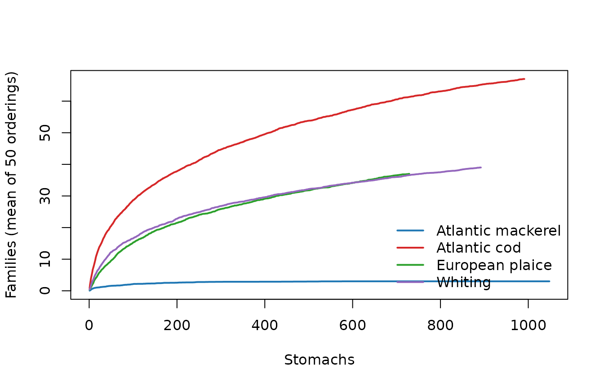

# Case study: a complete analysis of public ICES stomach data

This article is a complete diet study, from the raw table to the
figures, the tables and a dashboard, done only with DietView and a
little base R. The data are real: a public extract of the ICES Stomach
Content Database for fishes of the North Sea, the Skagerrak-Kattegat and
the Baltic Sea. The question is simple and classical: **what do the four
best-sampled predators in this extract (Atlantic mackerel, Atlantic cod,
European plaice and whiting) eat, how well do we know it, and how much
do their diets overlap?**

The sections follow the order of a real study. Each one opens with the
question it answers. Every number in the text is computed by the code
shown.

1.  [The question and the data](#data)
2.  [Checks and cleaning decisions](#cleaning)
3.  [Taxonomy](#taxonomy)
4.  [Covariates](#covariates)
5.  [The diet](#diet)
6.  [Figures](#figures)
7.  [Identification and digestion](#digestion)
8.  [Comparisons within cod](#comparisons)
9.  [Sampling sufficiency](#sufficiency)
10. [Resolution-robust aggregation and diet overlap](#aggregation)
11. [Outputs: dashboard, species cards, app](#outputs)
12. [What we learned, and the limits](#learned)

``` r

library(DietView)
m4 <- c("Atlantic mackerel", "Atlantic cod", "European plaice", "Whiting")
pc <- function(x, d = 1) formatC(x, format = "f", digits = d)   # format a %
```

## 1. The question and the data

*What is in the data, where does it come from, and how many fish were
sampled?*

Three tables ship with DietView. `ices_diet` has one row per prey
record, `ices_stomachs` one row per sampled stomach (empty ones
included), and `ices_lineage` the frozen WoRMS classification of every
prey. Source: ICES Stomach Content Database, ICES, Copenhagen; extract
distributed with the R package stomachr (Lindmark 2026). See
[`?ices_diet`](https://sosthenea.github.io/DietView/reference/ices_diet.md)
for the details and the corrections made when the tables were built.

``` r

c(records  = nrow(ices_diet),
  stomachs = length(unique(ices_diet$stomach_id)),
  sampled  = nrow(ices_stomachs),
  predators = length(unique(ices_diet$predator_common)))
#>   records  stomachs   sampled predators 
#>      9639      4231      8886        22
```

A stomach falls in one of three groups: it has prey records, it is
flagged empty, or it has no record and no “empty” flag, so its content
is unknown. The last group matters: it must not be counted as empty.

``` r

st <- ices_stomachs
st$status <- ifelse(st$stomach_empty %in% 1, "empty",
             ifelse(st$stomach_id %in% ices_diet$stomach_id, "with prey",
                    "unknown"))
tab <- table(st$predator_common, st$status)
tab <- tab[order(-rowSums(tab)), c("with prey", "empty", "unknown")]
head(tab, 8)
#>                          
#>                           with prey empty unknown
#>   Whiting                       896   294    1195
#>   European plaice               729   638     753
#>   Atlantic cod                  993    68     994
#>   Atlantic mackerel            1051     3       0
#>   Atlantic horse mackerel       135    61      97
#>   European hake                 106    32     149
#>   Tub gurnard                    90    22       9
#>   Thorny skate                   48     5      57
```

``` r

known <- tab[m4, "with prey"] + tab[m4, "empty"]
vac <- round(100 * tab[m4, "empty"] / known, 1)
vac
#> Atlantic mackerel      Atlantic cod   European plaice           Whiting 
#>               0.3               6.4              46.7              24.7
```

Of the 8886 stomachs, 1197 are flagged empty and 3458 have an unknown
status. Among stomachs of known status, the share of empty stomachs
(vacuity) ranges from 0.3% (Atlantic mackerel) to 46.7% (European
plaice). This can only be computed from `ices_stomachs`: a long prey
table holds no empty stomachs.

The sampling is uneven in space and time, which will matter for every
comparison:

``` r

table(st$region, st$year)
#>                     
#>                      2020 2021 2022 2023 2024
#>   Baltic Sea           33    0  180  233  264
#>   North Sea             0   52 2195 1212 1755
#>   Skagerrak-Kattegat    0    0 1027  820 1115
with(st[st$predator_common %in% m4, ], table(predator_common, year))
#>                    year
#> predator_common     2020 2021 2022 2023 2024
#>   Atlantic cod         0   52  270 1419  314
#>   Atlantic mackerel    0    0 1054    0    0
#>   European plaice      0    0    0    0 2120
#>   Whiting             33    0 1994  358    0
with(st[st$predator_common %in% m4, ], table(predator_common, quarter))
#>                    quarter
#> predator_common        1    2    3    4
#>   Atlantic cod      1208    0  428  419
#>   Atlantic mackerel    0 1054    0    0
#>   European plaice    984    0 1136    0
#>   Whiting           1262    0 1032   91
```

Mackerel were sampled in a single year and quarter, plaice in a single
year. Any contrast between predators is therefore also a contrast
between years, seasons and places.

## 2. Checks and cleaning decisions

*Is the table fit for DietView, and which records should count as diet?*

### Declare and validate

[`dv_spec()`](https://sosthenea.github.io/DietView/reference/dv_spec.md)
records which column plays which role.
[`dv_validate()`](https://sosthenea.github.io/DietView/reference/dv_validate.md)
checks the table against it and reports; it does not repair.

``` r

spec <- dv_spec(
  predator       = "predator_common",
  predator_latin = "predator_latin",
  stomach        = "stomach_id",
  prey_id        = "prey_aphia_id",
  prey_name      = "prey_name",
  weight         = "prey_weight_g",
  count          = "prey_count",
  digestion      = "digestion_label",
  covariates     = c("region", "year", "quarter")
)
v <- dv_validate(ices_diet, spec)
rep_raw <- attr(v, "dv_report")
unlist(rep_raw)
#>                n_records               n_stomachs              n_predators 
#>                     9639                     4231                       22 
#> n_single_record_stomachs         n_missing_weight            n_no_prey_key 
#>                     1595                      622                        0
```

No error and no warning: every record has a prey key (an AphiaID or a
name), weights are numbers and never negative, and stomach IDs are not
shared between predators. The report also tells us that 1595 stomachs
hold a single record and 622 records have no weight. Validation does not
say whether a record is food; that is our decision.

### Non-food items

``` r

table(ices_diet$item_type)
#> 
#>     non_food         prey unidentified 
#>           67         8019         1553
sort(table(ices_diet$prey_name[ices_diet$item_type == "non_food"]),
     decreasing = TRUE)
#> 
#>    sand   stone Plastic plastic    wood 
#>      47      14       4       1       1
```

Sand, stones, plastic and the like are not diet. They are dropped.

### Nematodes

Nematodes in fish stomachs are mostly parasites of the predator, not
prey. Before dropping them, we look at how much they weigh in each
predator’s records, because a decision that removes a large share of one
predator’s records is not a detail.

``` r

phylum <- ices_lineage$phylum[match(ices_diet$prey_aphia_id,
                                    ices_lineage$prey_aphia_id)]
is_nem <- phylum %in% "Nematoda"
nem <- tapply(is_nem, ices_diet$predator_common, mean)
nem_n <- tapply(is_nem, ices_diet$predator_common, sum)
round(100 * nem[m4], 1)
#> Atlantic mackerel      Atlantic cod   European plaice           Whiting 
#>              34.1               3.1               0.0               7.1
```

Nematodes make 1042 records (10.8% of all), and 34.1% of mackerel
records. Kept, they would make “Nematoda” one of the main prey of
mackerel. They are dropped; an analysis of parasites would keep them and
nothing else.

### Pooled fish, missing digestion, missing weight

``` r

pooled <- unique(ices_diet$stomach_id[ices_diet$n_fish_pooled %in% 2])
length(pooled)
#> [1] 7
dig_missing <- tapply(ices_diet$digestion_label == "not recorded",
                      ices_diet$predator_common, mean)
round(100 * dig_missing[m4], 1)
#> Atlantic mackerel      Atlantic cod   European plaice           Whiting 
#>              83.4              23.3              14.9              12.8
```

7 stomach samples pool two fish. They are too few to change any share,
so they are kept as stomachs. The digestion stage is “not recorded” for
33.7% of records overall, and for 83.4% of the mackerel records: the
digestion diagnostic below says little about mackerel. Missing digestion
is kept as its own level, not dropped. The 622 records without a weight
are kept too: they count in the record and numbers views and add nothing
to the weight view.

### The cleaned table

``` r

dat <- ices_diet[ices_diet$item_type != "non_food" & !is_nem, ]
rep_clean <- attr(dv_validate(dat, spec, quiet = TRUE), "dv_report")
```

The methods paragraph is generated from the counts, so it stays true if
the data or the decisions change:

``` r

cat(sprintf(paste(
  "We used %d prey records from %d stomachs of %d predator species",
  "(ICES Stomach Content Database, %d-%d). %d non-food records and %d nematode",
  "records (mostly parasites) were excluded. %d sampled stomachs were flagged",
  "empty and %d had no record and no flag; these were excluded from diet",
  "composition. %d records (%s%%) lacked a weight and %d (%s%%) a digestion stage."),
  rep_clean$n_records, rep_clean$n_stomachs, rep_clean$n_predators,
  min(dat$year), max(dat$year),
  sum(ices_diet$item_type == "non_food"), sum(is_nem),
  sum(st$status == "empty"), sum(st$status == "unknown"),
  rep_clean$n_missing_weight, pc(100 * rep_clean$n_missing_weight / rep_clean$n_records),
  sum(dat$digestion_label == "not recorded"),
  pc(100 * mean(dat$digestion_label == "not recorded"))))
```

We used 8530 prey records from 4222 stomachs of 22 predator species
(ICES Stomach Content Database, 2020-2024). 67 non-food records and 1042
nematode records (mostly parasites) were excluded. 1197 sampled stomachs
were flagged empty and 3458 had no record and no flag; these were
excluded from diet composition. 531 records (6.2%) lacked a weight and
2269 (26.6%) a digestion stage.

Dropping nematodes removed every record of 9 stomachs, which held
nothing else.

## 3. Taxonomy

*Is every prey placed in the classification, and to what depth?*

``` r

prep <- dv_prepare(dat, spec, taxonomy = "table", lineage = ices_lineage,
                   verbose = FALSE)
prep
#> <dietview_prep>
#>   records   : 8530 
#>   stomachs  : 4222 
#>   predators : 22 
#>   ranks     : kingdom > phylum > class > order > family > genus > species 
#>   covariates: region, year, quarter 
#>   source    : table
```

With a frozen lineage table there is no matching to review, so
`prep$taxonomy_log` is `NULL` and
[`dv_taxonomy_report()`](https://sosthenea.github.io/DietView/reference/dv_taxonomy_report.md)
says why:

``` r

is.null(prep$taxonomy_log)
#> [1] TRUE
tryCatch(dv_taxonomy_report(prep, which = "review"),
         error = function(e) conditionMessage(e))
#> [1] "No taxonomy log: this object was not prepared with taxonomy = 'worms'."
```

What we can check offline is the depth of identification: the WoRMS rank
of the name each record carries.

``` r

wr <- ices_lineage$worms_rank[match(dat$prey_aphia_id, ices_lineage$prey_aphia_id)]
wr[is.na(dat$prey_aphia_id)] <- "unidentified material"
sort(round(100 * prop.table(table(wr)), 1), decreasing = TRUE)[1:8]
#> wr
#>               Species unidentified material                 Class 
#>                  18.3                  18.2                  15.4 
#>                Family            Infraorder             Subphylum 
#>                  12.1                   6.8                   6.4 
#>                 Order                 Genus 
#>                   5.7                   5.3
```

Only 18.3% of the records are named to species, and 18.2% are
unidentified material with no AphiaID. Names at intermediate WoRMS ranks
(superorder, infraorder, …) are placed at the nearest of the seven ranks
above them, and the finer ranks are `NA`, shown below as the
unidentified share of their branch.

The lineage was built with WoRMS (via the stomachr package) and frozen,
so the article runs offline and gives the same answer every time. To
redo it against the live register, and get the per-prey matching log:

``` r

prep_w <- dv_prepare(dat, spec, taxonomy = "worms")      # needs 'worrms' + internet
dv_taxonomy_report(prep_w, which = "review")             # fuzzy, synonyms, homonyms
# or resolve the keys only, then freeze the table yourself:
lin <- dv_taxonomy_worms(unique(dat$prey_aphia_id[!is.na(dat$prey_aphia_id)]))
```

## 4. Covariates

*Which strata do we want to compare, and how are they defined?*

Two derived covariates: a period, with breaks written out so they are
part of the method, and a length class with breaks specific to each
predator (a 30 cm whiting is large, a 30 cm cod is not). The breaks are
close to the quartiles of each predator’s lengths.

``` r

dat$period <- dv_add_period(dat$year, breaks = c(2020, 2022, 2024))
table(dat$period)
#> 
#> 2020-2022 2023-2024 
#>      3426      5104

len_breaks <- list("Atlantic mackerel" = c(15, 28, 34, 50),
                   "Atlantic cod"      = c(0, 25, 40, 110),
                   "European plaice"   = c(10, 22, 30, 60),
                   "Whiting"           = c(5, 20, 28, 50))
dat$length_class <- NA_character_
for (p in m4) {
  i <- dat$predator_common == p
  dat$length_class[i] <- as.character(dv_size_bins(dat$length_cm[i], len_breaks[[p]]))
}
with(dat[dat$predator_common %in% m4, ], table(predator_common, length_class))
#>                    length_class
#> predator_common     [0, 25) [10, 22) [15, 28) [20, 28) [22, 30) [25, 40)
#>   Atlantic cod          635        0        0        0        0      939
#>   Atlantic mackerel       0        0      341        0        0        0
#>   European plaice         0      506        0        0      808        0
#>   Whiting                 0        0        0      691        0        0
#>                    length_class
#> predator_common     [28, 34) [28, 50) [30, 60) [34, 50) [40, 110) [5, 20)
#>   Atlantic cod             0        0        0        0       730       0
#>   Atlantic mackerel      604        0        0      648         0       0
#>   European plaice          0        0      576        0         0       0
#>   Whiting                  0      411        0        0         0     503
```

The analysis from here on uses the four predators, with the new
covariates declared in the spec.

``` r

spec4 <- dv_spec(predator = "predator_common", predator_latin = "predator_latin",
                 stomach = "stomach_id", prey_id = "prey_aphia_id",
                 prey_name = "prey_name", weight = "prey_weight_g",
                 count = "prey_count", digestion = "digestion_label",
                 covariates = c("region", "quarter", "period", "length_class"))
d4 <- dat[dat$predator_common %in% m4, ]
prep_of <- function(rows) dv_prepare(d4[rows, ], spec4, taxonomy = "table",
                                     lineage = ices_lineage, verbose = FALSE)
prep4 <- prep_of(TRUE)
by_pred <- lapply(setNames(m4, m4), function(p) prep_of(d4$predator_common == p))
prep4
#> <dietview_prep>
#>   records   : 7392 
#>   stomachs  : 3660 
#>   predators : 4 
#>   ranks     : kingdom > phylum > class > order > family > genus > species 
#>   covariates: region, quarter, period, length_class 
#>   source    : table
```

## 5. The diet

*What do the four predators eat, in records, in numbers and in weight?*

[`dv_tree()`](https://sosthenea.github.io/DietView/reference/dv_tree.md)
builds the tree at all seven ranks. Each node carries prey records
(`value_occ`, or individuals with `currency = "numbers"`) and weight
(`value_w`), with their shares within the rank (`pct_occ`, `pct_w`).

``` r

tr_rec <- lapply(by_pred, dv_tree)
tr_num <- lapply(by_pred, function(p)
  withCallingHandlers(dv_tree(p, currency = "numbers"),
                      warning = function(w) invokeRestart("muffleWarning")))
n_nocount <- sum(is.na(d4$prey_count))
```

The numbers currency counts individuals; 3214 records (43.5%) have no
count, mostly unidentified material, and contribute nothing to it
(DietView warns about this; the warning is muffled here).

### Class rank

[`dv_rank_table()`](https://sosthenea.github.io/DietView/reference/dv_rank_table.md)
returns one ring of the tree, sorted by record share:

``` r

head(dv_rank_table(tr_rec[["Atlantic cod"]], "Class"), 4)
#>           label value_item value_occ   pct_occ  value_w     pct_w
#> 14 Malacostraca         62       999 43.359375 2286.830 22.361624
#> 17    Teleostei         46       624 27.083333 7045.949 68.898369
#> 27           NA          1       192  8.333333  123.520  1.207833
#> 18           NA          1       153  6.640625  248.537  2.430304
```

A ring can hold several `NA` nodes, one per branch: the records
identified to a phylum but not to a class sit in an `NA` node under that
phylum. The tables below label each one by its deepest named ancestor
(“Chordata, unid.” is fish material not resolved to class, such as
“Pisces”) and give the share of records (%R), of individuals (%N) and of
weight (%W).

``` r

rank_tab <- function(p, rank, n = 6) {
  t <- tr_rec[[p]]; r <- t[t$rank == rank, ]; r <- r[order(-r$pct_occ), ]
  nn <- tr_num[[p]]
  anc <- vapply(strsplit(r$id, "|", fixed = TRUE),   # deepest named ancestor
                function(x) { x <- x[x != "NA"]; if (length(x)) tail(x, 1) else "" }, "")
  lab <- ifelse(r$label != "NA", r$label,
                ifelse(nzchar(anc), paste0(anc, ", unid."), "unidentified"))
  out <- data.frame(taxon = lab, records = r$value_occ,
                    pct_R = round(r$pct_occ, 1),
                    pct_N = round(nn$pct_occ[match(r$id, nn$id)], 1),
                    pct_W = round(r$pct_w, 1))
  head(out, n)
}
for (p in m4) { cat("\n", p, "\n"); print(rank_tab(p, "Class"), row.names = FALSE) }
#> 
#>  Atlantic mackerel 
#>              taxon records pct_R pct_N pct_W
#>       unidentified     817  51.3   2.3  40.6
#>          Teleostei     348  21.8  70.8  40.1
#>  Arthropoda, unid.     244  15.3   0.6  14.7
#>    Chordata, unid.     181  11.4  25.8   4.5
#>       Malacostraca       3   0.2   0.4   0.0
#> 
#>  Atlantic cod 
#>              taxon records pct_R pct_N pct_W
#>       Malacostraca     999  43.4  55.0  22.4
#>          Teleostei     624  27.1  25.9  68.9
#>       unidentified     192   8.3   0.7   1.2
#>    Chordata, unid.     153   6.6   3.0   2.4
#>         Polychaeta     144   6.2   4.9   3.7
#>  Arthropoda, unid.      68   3.0   2.5   0.5
#> 
#>  European plaice 
#>                 taxon records pct_R pct_N pct_W
#>            Polychaeta     527  27.9  28.3  15.1
#>           Ophiuroidea     443  23.4  18.8  49.1
#>              Bivalvia     265  14.0  11.7  17.9
#>          unidentified     261  13.8   0.0   2.0
#>          Malacostraca     213  11.3  26.9   2.4
#>  Echinodermata, unid.      61   3.2   2.9   2.2
#> 
#>  Whiting 
#>              taxon records pct_R pct_N pct_W
#>       Malacostraca     536  33.4  39.0  12.3
#>    Chordata, unid.     264  16.4   6.4  25.5
#>          Teleostei     249  15.5   9.0  52.3
#>  Arthropoda, unid.     228  14.2  17.0   3.1
#>       unidentified     188  11.7   1.3   2.6
#>         Polychaeta      46   2.9   1.3   0.8
```

### Family rank

``` r

for (p in m4) { cat("\n", p, "\n"); print(rank_tab(p, "Family", 5), row.names = FALSE) }
#> 
#>  Atlantic mackerel 
#>              taxon records pct_R pct_N pct_W
#>       unidentified     817  51.3   2.3  40.6
#>        Ammodytidae     318  20.0  64.4  34.4
#>  Arthropoda, unid.     244  15.3   0.6  14.7
#>    Chordata, unid.     181  11.4  25.8   4.5
#>            Gadidae      17   1.1   3.6   1.3
#> 
#>  Atlantic cod 
#>            taxon records pct_R pct_N pct_W
#>  Decapoda, unid.     285  12.4  12.8   5.9
#>         Gobiidae     242  10.5  10.1   1.7
#>      Crangonidae     240  10.4  11.6   0.7
#>     unidentified     192   8.3   0.7   1.2
#>          Gadidae     171   7.4   6.7  46.0
#> 
#>  European plaice 
#>               taxon records pct_R pct_N pct_W
#>  Ophiuroidea, unid.     417  22.1  14.4  48.6
#>   Polychaeta, unid.     338  17.9  14.5  11.3
#>     Bivalvia, unid.     263  13.9  11.7  17.9
#>        unidentified     261  13.8   0.0   2.0
#>       Pectinariidae      84   4.4   2.0   2.1
#> 
#>  Whiting 
#>              taxon records pct_R pct_N pct_W
#>    Chordata, unid.     264  16.4   6.4  25.5
#>  Arthropoda, unid.     228  14.2  17.0   3.1
#>    Decapoda, unid.     212  13.2  13.8   4.7
#>       unidentified     188  11.7   1.3   2.6
#>            Gadidae      86   5.4   3.0  22.5
```

Among identified classes, the leading one by records is Teleostei for
mackerel (21.8%), Malacostraca for cod (43.4%), Polychaeta for plaice
(27.9%) and Malacostraca for whiting (33.4%). By weight it is Teleostei
(40.1%), Teleostei (68.9%), Ophiuroidea (49.1%) and Teleostei (52.3%)
respectively. The record and weight currencies answer different
questions (how often a prey is eaten, and how much of the food it
makes), and they disagree most where prey sizes differ most: a fish is
heavy, a copepod is not.

### Invariants, checked in code

DietView keeps the unidentified material in every ring, so each rank
accounts for all the records and all the weight. These are checked, not
assumed:

``` r

for (p in m4) {
  t <- tr_rec[[p]]; n <- nrow(by_pred[[p]]$data)
  w <- sum(by_pred[[p]]$data$prey_weight_g, na.rm = TRUE)
  for (r in unique(t$rank)) {
    x <- t[t$rank == r, ]
    stopifnot(abs(sum(x$pct_occ) - 100) < 1e-8,       # every ring sums to 100%
              sum(x$value_occ) == n,                  # ... and holds every record
              abs(sum(x$value_w) - w) < 1e-6)         # ... and all the weight
  }
  # the NA node at class rank holds exactly the records not identified to class
  stopifnot(sum(t$value_occ[t$rank == "Class" & t$label == "NA"]) ==
              sum(is.na(by_pred[[p]]$data$class)))
  # a parent equals the sum of its children
  kids <- tapply(t$value_occ, t$parent, sum)
  par <- t$value_occ[match(names(kids), t$id)]
  stopifnot(all(kids[!is.na(par)] == par[!is.na(par)]))
}
"all invariants hold"
#> [1] "all invariants hold"
```

### Frequency of occurrence versus record share

The classical %FO (share of stomachs containing a taxon) is not the
record share: a taxon present as several records per stomach gets a
large record share, a taxon present once in many stomachs a large %FO.

``` r

fo <- dv_fo_table(prep4, rank = "class", by = "predator_common")
fo_vs <- do.call(rbind, lapply(m4, function(p) {
  r <- dv_rank_table(tr_rec[[p]], "Class")
  f <- fo[fo$predator_common == p, ]
  data.frame(predator = p, taxon = r$label, pct_R = round(r$pct_occ, 1),
             pct_FO = f$pct_fo[match(r$label, f$taxon)],
             rec_per_stomach = round(r$value_occ / f$n_stomachs[match(r$label, f$taxon)], 2))
}))
fo_vs <- fo_vs[fo_vs$taxon != "NA", ]      # identified classes only
fo_vs$gap <- fo_vs$pct_FO - fo_vs$pct_R
head(fo_vs[order(-abs(fo_vs$gap)), ], 6)
#>             predator        taxon pct_R pct_FO rec_per_stomach    gap
#> 23   European plaice   Polychaeta  27.9  53.77            1.34  25.87
#> 24   European plaice  Ophiuroidea  23.4  45.40            1.34  22.00
#> 25   European plaice     Bivalvia  14.0  34.98            1.04  20.98
#> 6       Atlantic cod Malacostraca  43.4  62.36            1.62  18.96
#> 27   European plaice Malacostraca  11.3  21.81            1.34  10.51
#> 2  Atlantic mackerel    Teleostei  21.8  11.64            2.85 -10.16
id <- fo$taxon != "NA"
fo_sum <- tapply(fo$pct_fo[id], fo$predator_common[id], sum)
round(fo_sum[m4])
#> Atlantic mackerel      Atlantic cod   European plaice           Whiting 
#>                12               121               167                76
```

The largest gap is for Polychaeta in European plaice: found in 53.77% of
stomachs but 27.9% of records. Two things drive the gap. First, the
record share has all records as its denominator, and a European plaice
stomach holds 2.59 records on average, so a taxon present once per
stomach gets a record share well below its %FO. Second, a taxon recorded
several times per stomach (`rec_per_stomach` above 1) gains record share
relative to %FO. %FO is also not additive: a stomach with fish and
shrimp counts in both, so %FO over the identified classes sums to 12 to
167% here, while the record share sums to exactly 100% with the
unidentified nodes. Report %FO next to the record share, never in its
place.

## 6. Figures

*How do we show seven ranks at once, comparably across predators?*

One palette is built from the pooled tree of the four predators, so a
taxon has the same color in every panel.
[`dv_palette_tree()`](https://sosthenea.github.io/DietView/reference/dv_palette_tree.md)
colors by branch (each phylum a hue);
[`dv_palette()`](https://sosthenea.github.io/DietView/reference/dv_palette.md)
gives each label its own color.

``` r

tree4 <- dv_tree(prep4)
pal <- dv_palette_tree(tree4)
length(pal)
#> [1] 653
head(dv_palette(tree4$label[tree4$rank == "Class"]), 4)
#> Clitellata   Gephyrea Polychaeta   Copepoda 
#>  "#1f77b4"  "#aec7e8"  "#ff7f0e"  "#ffbb78"
```

Prey records (`mode = "occurrence"`; the default, `"count"`, would count
distinct prey items). White wedges are records not identified at that
rank.

``` r

htmltools::tagList(lapply(m4, function(p)
  dv_sunburst(tr_rec[[p]], mode = "occurrence", colors = pal, title = p,
              subtitle = "% of prey records")))
```

The same, by weight:

``` r

htmltools::tagList(lapply(m4, function(p)
  dv_sunburst(tr_rec[[p]], mode = "weight", colors = pal, title = p,
              subtitle = "% of prey weight")))
```

## 7. Identification and digestion

*How deep is the identification, and does it fall as digestion
advances?*

``` r

dg <- dv_digestion_diagnostic(prep4, by = "predator_common")
stages <- c("0 pristine", "1 affected", "2 skeletal remains", "not recorded")
dg$digestion <- factor(dg$digestion, levels = stages)
sp_tab <- xtabs(p_records ~ by + digestion, dg[dg$finest_rank == "Species", ])
n_tab <- xtabs(n_records ~ by + digestion, dg)
sp_tab[n_tab == 0] <- NA        # no record at that stage
round(sp_tab[m4, ], 1)
#>                    digestion
#> by                  0 pristine 1 affected 2 skeletal remains not recorded
#>   Atlantic mackerel        1.5        9.9                0.0          0.1
#>   Atlantic cod            68.6       50.9               15.0         20.0
#>   European plaice         33.3        2.2                0.4          0.0
#>   Whiting                 26.8       26.4                9.5          9.3
```

The table shows the share of records identified to species at each
digestion stage (`NA`: no record at that stage). The stage labels are
inferred: the ICES export gives codes 0, 1 and 2, and the labels come
from the older ICES format whose three classes match the shares of these
codes. Check them against the ICES vocabulary before using them in
print.

For cod, 68.6% of pristine records are identified to species, against
15.0% of skeletal remains. Any diet built from identified prey alone
over-represents the prey that are digested slowly or eaten recently.

The unidentified share at each rank (the white wedges) for each
predator:

``` r

unid <- sapply(tr_rec, function(t) {
  x <- t[t$label == "NA", ]
  tapply(x$pct_occ, factor(x$rank, levels = unique(t$rank)), sum)
})
round(unid, 1)
#>         Atlantic mackerel Atlantic cod European plaice Whiting
#> Kingdom              51.3          8.3            13.8    11.7
#> Phylum               51.3          8.3            13.8    11.7
#> Class                78.0         18.4            19.0    44.0
#> Order                78.0         23.3            77.9    48.5
#> Family               78.2         39.4            85.7    69.3
#> Genus                98.2         52.5            91.4    77.0
#> Species              98.2         60.9            99.0    80.6
```

## 8. Comparisons within cod

*Does the cod diet change between regions, length classes and periods?*

Cod is the predator sampled across all three regions, both periods and a
wide range of lengths. Each stratum gets its own tree; we compare the
class shares (%R).

``` r

cod <- d4$predator_common == "Atlantic cod"
compare <- function(col) {
  lv <- sort(unique(na.omit(d4[[col]][cod])))
  ps <- lapply(lv, function(l) prep_of(cod & d4[[col]] %in% l))
  sh <- lapply(ps, function(p) {
    r <- dv_rank_table(dv_tree(p), "Class"); tapply(r$pct_occ, r$label, sum) })
  tx <- head(names(sort(-tapply(unlist(sh), names(unlist(sh)), sum))), 6)
  out <- sapply(sh, function(s) round(ifelse(is.na(s[tx]), 0, s[tx]), 1))
  out <- rbind(out, stomachs = sapply(ps, function(p) length(unique(p$data$stomach_id))))
  dimnames(out) <- list(c(tx, "stomachs"), lv); out
}
(cod_region <- compare("region"))
#>              Baltic Sea North Sea Skagerrak-Kattegat
#> Malacostraca       38.1      45.3               35.6
#> Teleostei          25.8      27.4               26.7
#> NA                 31.2      15.2               18.5
#> Polychaeta          1.9       6.6               15.6
#> Ophiuroidea         0.0       2.8                0.7
#> Bivalvia            1.9       1.2                0.0
#> stomachs          198.0     731.0               62.0
(cod_length <- compare("length_class"))
#>              [0, 25) [25, 40) [40, 110)
#> Malacostraca    58.0     40.6      34.2
#> Teleostei       14.2     23.9      42.5
#> NA              18.6     21.2      14.7
#> Polychaeta       6.3      7.0       5.2
#> Ophiuroidea      0.9      3.2       1.9
#> Bivalvia         0.5      2.4       0.4
#> stomachs       346.0    418.0     227.0
(cod_period <- compare("period"))
#>              2020-2022 2023-2024
#> Malacostraca      57.6      38.4
#> Teleostei         19.9      29.6
#> NA                 6.7      22.5
#> Polychaeta         8.0       5.6
#> Ophiuroidea        4.7       1.3
#> Bivalvia           2.0       1.0
#> stomachs         227.0     764.0
(cod_cells <- with(unique(d4[cod, c("stomach_id", "length_class", "period")]),
                   table(length_class, period)))
#>             period
#> length_class 2020-2022 2023-2024
#>    [0, 25)         108       238
#>    [25, 40)         76       342
#>    [40, 110)        43       184
```

Fish (Teleostei) make 14.2% of the records of cod \[0, 25) cm and 42.5%
of cod \[40, 110) cm: the shift towards fish with size is the clearest
contrast in these data. Between regions, malacostracans range from 35.6%
to 45.3%. `NA` here sums the unidentified nodes of all branches. The
smallest single stratum has 62 stomachs, but crossing length class with
period, as the dashboard does below, leaves cells of 43 stomachs. With a
few dozen stomachs, a handful of fish with many records can move a share
by tens of percent, so small cells are read as hints, not results.
Region, period and length are also confounded here (the Baltic samples
come from different surveys and years), so these are descriptions of the
samples, not effects.

## 9. Sampling sufficiency

*Have we sampled enough stomachs to describe each diet?*

``` r

dv_summary(prep4)
#>     predator_common n_stomachs n_records n_taxa records_per_stomach
#> 1 Atlantic mackerel       1048      1593     10                1.52
#> 2      Atlantic cod        991      2304    144                2.32
#> 3           Whiting        892      1605    101                1.80
#> 4   European plaice        729      1890     69                2.59
#>   total_weight
#> 1     2064.350
#> 2    10226.583
#> 3     2028.399
#> 4     1020.806
dv_summary(prep4, rank = "family")[, c("predator_common", "n_stomachs", "n_taxa")]
#>     predator_common n_stomachs n_taxa
#> 1 Atlantic mackerel       1048      3
#> 2      Atlantic cod        991     67
#> 3           Whiting        892     39
#> 4   European plaice        729     37
```

`n_taxa` at the finest label mixes ranks (a family and a species in it
count twice); at family rank it counts families. Accumulation curves,
averaged over random orderings of the stomachs, show whether new
stomachs still bring new families:

``` r

acc <- dv_prey_accumulation(prep4, by = "predator_common", rank = "family",
                            permutations = 50, seed = 1)
cols <- c("#1f77b4", "#d62728", "#2ca02c", "#9467bd")
plot(NA, xlim = c(0, max(acc$n_stomachs)), ylim = c(0, max(acc$mean_richness)),
     xlab = "Stomachs", ylab = "Families (mean of 50 orderings)")
for (i in seq_along(m4)) with(acc[acc$predator_common == m4[i], ],
                               lines(n_stomachs, mean_richness, col = cols[i], lwd = 2))
legend("bottomright", m4, col = cols, lwd = 2, bty = "n")
```



``` r

gain <- sapply(m4, function(p) {
  a <- acc[acc$predator_common == p, ]; n <- nrow(a)
  c(stomachs = a$n_stomachs[n], families = round(a$mean_richness[n], 1),
    last_100 = round(a$mean_richness[n] - a$mean_richness[n - 100], 1))
})
gain
#>          Atlantic mackerel Atlantic cod European plaice Whiting
#> stomachs              1048        991.0           729.0   892.0
#> families                 3         67.0            37.0    39.0
#> last_100                 0          1.8             2.2     1.6
```

`last_100` is the number of new families brought by the last 100
stomachs. A curve that still rises (cod: 1.8 families in its last 100
stomachs) means rare prey are still being found; the common part of the
diet, which dominates the shares, settles much earlier.

## 10. Resolution-robust aggregation and diet overlap

*Can we describe the diets at a resolution that does not depend on how
deeply each prey happened to be identified, and how similar are they?*

Prey seen in fewer than `threshold` stomachs are merged into their
parent taxon until every category reaches the threshold. A sweep shows
the cost of each choice:

``` r

n_stom <- tapply(prep4$data$stomach_id, prep4$data$predator_common,
                 function(x) length(unique(x)))
th <- ceiling(0.01 * min(n_stom))
sw <- dv_threshold_sweep(prep4, sort(unique(c(1, 2, 5, th, 10, 20, 50))))
sw
#>   threshold n_categories pct_coarser
#> 1         1          211       83.01
#> 2         2          148       83.59
#> 3         5          100       84.75
#> 4         8           78       85.46
#> 5        10           71       85.57
#> 6        20           52       86.95
#> 7        50           26       92.09
```

`pct_coarser` is the share of records that end coarser than species (or
unidentified). The curve has no clear elbow, so we state a rule instead:
**a category must occur in at least 1% of the stomachs of the
least-sampled predator** (European plaice, 729 stomachs), which gives a
threshold of 8 stomachs: a category rarer than that in the pooled data
could hardly be compared between predators.

``` r

agg <- dv_aggregate_threshold(prep4, threshold = th)
agg_pp <- dv_aggregate_threshold(prep4, threshold = th, scope = "per_predator")
c(pooled = length(unique(agg$data$prey_category)),
  per_predator = length(unique(paste(agg_pp$data$predator_common,
                                     agg_pp$data$prey_category))))
#>       pooled per_predator 
#>           79          115
table(agg$data$prey_rank, useNA = "ifany")
#> 
#>   class  family   genus kingdom   order  phylum species    <NA> 
#>    1360     823     366      18    1025    1267    1075    1458
```

With a threshold of 8 stomachs, the pooled aggregation keeps 79
categories shared by the four predators. The per-predator version adapts
the resolution to each predator’s own sample, which suits
single-predator descriptions but makes the categories differ between
predators. For comparing predators we use the pooled one.

[`dv_matrix()`](https://sosthenea.github.io/DietView/reference/dv_matrix.md)
hands the result over as a matrix. With stomachs as rows it is the input
of ordination or PERMANOVA; with predators as the unit, it gives one
diet vector per predator:

``` r

m_st <- dv_matrix(agg, currency = "occurrence")
dim(m_st)
#> [1] 3660   79
m_pred <- dv_matrix(agg, unit = "predator_common", currency = "occurrence",
                    include_na = FALSE)
m_w <- dv_matrix(agg, unit = "predator_common", currency = "weight",
                 include_na = FALSE)
```

Schoener’s overlap index, `1 - 0.5 * sum(|p_i - p_j|)`, compares two
diets as proportions (0: no shared prey, 1: identical). Unidentified
material is left out, as it cannot be shared knowingly.

``` r

schoener <- function(m) {
  p <- m / rowSums(m)
  o <- outer(seq_len(nrow(p)), seq_len(nrow(p)),
             Vectorize(function(i, j) 1 - 0.5 * sum(abs(p[i, ] - p[j, ]))))
  dimnames(o) <- list(rownames(m), rownames(m)); round(o, 2)
}
(ov_rec <- schoener(m_pred))
#>                   Atlantic cod Atlantic mackerel European plaice Whiting
#> Atlantic cod              1.00              0.15            0.18    0.51
#> Atlantic mackerel         0.15              1.00            0.02    0.40
#> European plaice           0.18              0.02            1.00    0.16
#> Whiting                   0.51              0.40            0.16    1.00
(ov_w <- schoener(m_w))
#>                   Atlantic cod Atlantic mackerel European plaice Whiting
#> Atlantic cod              1.00              0.12            0.04    0.39
#> Atlantic mackerel         0.12              1.00            0.01    0.22
#> European plaice           0.04              0.01            1.00    0.04
#> Whiting                   0.39              0.22            0.04    1.00
```

By records, the most similar pair is Whiting and Atlantic cod (0.51),
the least similar European plaice and Atlantic mackerel (0.02). Values
below about 0.6 are conventionally read as no biologically significant
overlap. The same matrix at the stomach level (`m_st`) is what a
multivariate analysis would start from, for instance with
`vegan::vegdist(m_st, "bray")`.

## 11. Outputs: dashboard, species cards, app

*How do we share the results with people who will not run R?*

### Species cards

Each dashboard card can show a photo with its author and license.
Offline, we draw a placeholder for each predator with
[`grDevices::png()`](https://rdrr.io/r/grDevices/png.html), name it
after the predator in the image folder, and give the credit fields
explicitly.

``` r

img <- file.path(tempdir(), "ices-images")
dir.create(img, showWarnings = FALSE)
for (p in m4) {
  grDevices::png(file.path(img, paste0(tolower(gsub("[^A-Za-z0-9]+", "_", p)), ".png")),
                 width = 300, height = 180)
  par(mar = c(0, 0, 0, 0)); plot.new(); rect(0, 0, 1, 1, col = "#dbe9f6", border = NA)
  text(0.5, 0.5, p, cex = 1.6)
  grDevices::dev.off()
}
info <- lapply(setNames(m4, m4), function(p)
  list(desc = sprintf("%s: %d stomachs with prey in this extract.", p,
                      length(unique(by_pred[[p]]$data$stomach_id))),
       author = "DietView placeholder", license = "CC0"))
a <- dv_species_card_assets("Atlantic cod", latin = "Gadus morhua",
                            info = info[["Atlantic cod"]], image_dir = img)
a[c("source", "credit", "desc")]
#> $source
#> [1] "local"
#> 
#> $credit
#> [1] "Photo: DietView placeholder, CC0"
#> 
#> $desc
#> [1] "Atlantic cod: 991 stomachs with prey in this extract."
```

With network access, an openly licensed iNaturalist photo comes with its
author and license; only the licenses you list are accepted:

``` r

dv_species_card_assets("Atlantic cod", latin = "Gadus morhua",
                       photo_source = "inaturalist",
                       licenses = c("cc0", "cc-by", "cc-by-sa"),
                       image_dir = img)
```

### The dashboard

One self-contained HTML file: a card per predator, and for each a band
of sunbursts per currency (distinct prey items, records, weight),
stratified by region and quarter, plus length class crossed with period.

``` r

out <- file.path(tempdir(), "ices_dashboard.html")
t0 <- Sys.time()
dv_build_html(prep4, output = out,
              strata = c("region", "quarter"),
              cross = list(c("length_class", "period")),
              length_col = "length_cm",
              species_info = info, image_dir = img,
              title = "ICES stomach data: four North-East Atlantic predators")
c(MB = round(file.size(out) / 1e6, 1),
  seconds = round(as.numeric(Sys.time() - t0, units = "secs")))
#>      MB seconds 
#>    14.8    18.0
```

The file is written to
[`tempdir()`](https://rdrr.io/r/base/tempfile.html), so it is not part
of this website; run the chunk to get your own copy and open it in a
browser.
[`dv_deploy()`](https://sosthenea.github.io/DietView/reference/dv_deploy.md)
writes the same file into a folder you serve. Each sunburst carries its
own data, so the size grows with bands and strata; a version with the
record band and the regions only is much lighter:

``` r

path <- dv_deploy(prep4, file = "ices_records.html",
                  dir = file.path(tempdir(), "site"),
                  bands = "occurrence", strata = "region",
                  species_info = info, image_dir = img)
round(file.size(path) / 1e6, 1)
#> [1] 5.6
```

### The app

For exploring rather than publishing, the Shiny app takes the same
object:

``` r

run_dietview(prep4)
```

## 12. What we learned, and the limits

*What do the numbers say about these four predators, and how far can we
trust them?*

- **Mackerel** (1048 stomachs, one quarter of one year) is the least
  identified diet: 51.3% of its records are unidentified material. What
  is identified is fish (33.2% of records, mostly Ammodytidae,
  i.e. sandeels: 20.0% of records and 34.4% of weight) and crustaceans
  (15.5%). It has the fewest families (3).
- **Cod** (991 stomachs) is the most generalist (67 families):
  Malacostraca lead by records (43.4%), but Teleostei make 68.9% of the
  weight, and the share of fish rises from 14.2% to 42.5% of records
  with length.
- **Plaice** (729 stomachs) feeds on the bottom fauna: Polychaeta lead
  by records (27.9%), Ophiuroidea (brittle stars) by weight (49.1%),
  with almost no fish (0.4% of records are chordates).
- **Whiting** (892 stomachs) eats Malacostraca most often (33.4% of
  records) but Teleostei by weight (52.3%), and much of its stomach
  content is unidentified (44.0% of records at class rank).
- The diets overlap little: the highest Schoener index between two
  predators is 0.51 by records (Whiting and Atlantic cod), below the
  conventional 0.6, and European plaice is the most isolated (overlap at
  most 0.18 with any other).

The limits are those of the data, and they bound every sentence above:

- **A survey extract.** These are the stomachs some surveys sampled, in
  some years and quarters, not a design for diet comparison. Predator,
  year, season and region are confounded (mackerel: one quarter of one
  year).
- **Uneven sampling.** A predator-by-region stratum holds from 38 to 948
  stomachs, and 3458 sampled stomachs have no known status.
- **Inferred digestion labels.** The stage names attached to ICES codes
  0, 1 and 2 are an inference; the diagnostic depends on the codes, the
  words do not.
- **No uncertainty.** Every share here is a point estimate. Stomachs,
  not records, are the independent units, so the natural next step is a
  bootstrap over stomachs (resample stomach IDs within each predator and
  stratum, rebuild the tree with
  [`dv_tree()`](https://sosthenea.github.io/DietView/reference/dv_tree.md),
  and take percentile intervals of `pct_occ` and `pct_w`), or over hauls
  when fish from one haul share a meal.

*This article ran in about 28 seconds.*
