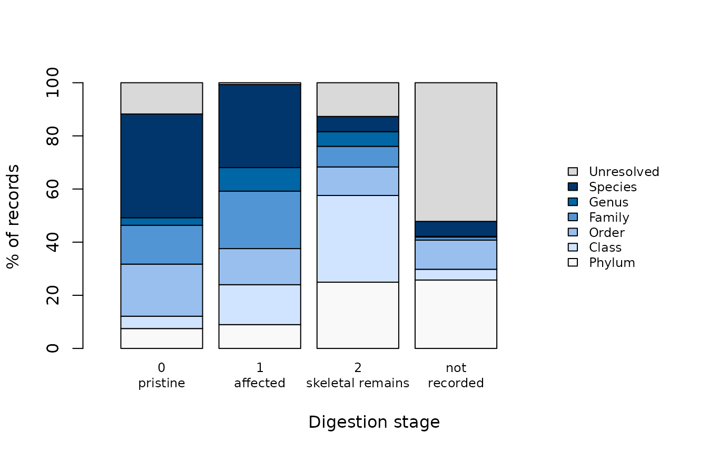

# Identification depth and digestion

The more digested a prey item, the coarser the rank it can be named to.
That matters because digestion is not even across prey. Soft-bodied prey
lose their identifying features faster than fish with otoliths or
crustaceans with hard parts, so the material that can still be
identified to species is a biased sample of what was eaten. Buckland et
al. (2017) asked diet studies to report how prey condition affected
identification.
[`dv_digestion_diagnostic()`](https://sosthenea.github.io/DietView/reference/dv_digestion_diagnostic.md)
gives you that table.

The data are the public ICES stomach-content extract that ships with the
package (ICES Stomach Content Database, ICES, Copenhagen; extract
distributed with the R package stomachr, Lindmark 2026; see
[`?ices_diet`](https://sosthenea.github.io/DietView/reference/ices_diet.md)),
prepared as in the getting-started vignette.

``` r

library(DietView)

# drop non-food items and nematodes (mostly parasites, not prey)
phylum <- ices_lineage$phylum[match(ices_diet$prey_aphia_id, ices_lineage$prey_aphia_id)]
dat <- ices_diet[ices_diet$item_type != "non_food" & !phylum %in% "Nematoda", ]

spec <- dv_spec(
  predator       = "predator_common",
  predator_latin = "predator_latin",
  stomach        = "stomach_id",
  prey_id        = "prey_aphia_id",
  prey_name      = "prey_name",
  weight         = "prey_weight_g",
  count          = "prey_count",
  digestion      = "digestion_label",
  covariates     = c("region", "year", "quarter")
)
prep <- dv_prepare(dat, spec, taxonomy = "table", lineage = ices_lineage,
                   verbose = FALSE)
```

## A caveat on the stages

ICES records digestion as a code, 0, 1 or 2. The labels used here (“0
pristine”, “1 affected”, “2 skeletal remains”) are inferred from the
older ICES format, whose three classes match the shares of these codes;
they are not taken from the ICES vocabulary. Read the stages as an
ordered scale from fresh to digested and check the labels against the
ICES documentation before you quote them. Records whose stage was not
reported are kept as “not recorded”.

## What the diagnostic computes

For every record, DietView finds the deepest rank with a name: its
*finest resolved rank*. Records with no name at any rank are
“Unresolved”. Within each digestion stage it then reports the share of
records, and of weight, at each finest rank.

``` r

diag <- dv_digestion_diagnostic(prep)
head(diag[, c("digestion", "finest_rank", "n_records", "p_records", "p_weight")], 7)
#>    digestion finest_rank n_records p_records   p_weight
#> 1 0 pristine      Phylum        42  7.486631  3.1594482
#> 2 0 pristine       Class        26  4.634581  0.2300241
#> 3 0 pristine       Order       110 19.607843  2.2952781
#> 4 0 pristine      Family        82 14.616756  9.2883107
#> 5 0 pristine       Genus        16  2.852050  0.8581803
#> 6 0 pristine     Species       219 39.037433 82.5783551
#> 7 0 pristine  Unresolved        66 11.764706  1.5904035
```

Side by side, the record shares are easier to read:

``` r

round(xtabs(p_records ~ finest_rank + digestion, data = diag), 1)
#>             digestion
#> finest_rank  0 pristine 1 affected 2 skeletal remains not recorded
#>   Kingdom           0.0        0.0                0.0          0.0
#>   Phylum            7.5        9.0               24.9         25.7
#>   Class             4.6       15.0               32.6          4.1
#>   Order            19.6       13.6               10.7         11.0
#>   Family           14.6       21.6                7.8          1.1
#>   Genus             2.9        8.9                5.5          0.3
#>   Species          39.0       31.3                5.7          5.6
#>   Unresolved       11.8        0.7               12.7         52.2
n_stage <- tapply(diag$n_records, diag$digestion, sum)
n_stage
#>         0 pristine         1 affected 2 skeletal remains       not recorded 
#>                561               3494               2206               2269
```

Percentages are computed within each stage, so each stage adds up to
100% whatever its sample size. Always read them next to `n_records`:
here the four columns hold 561, 3,494, 2,206, 2,269 records
respectively.

Pooled, the share named to genus or species changes little between stage
0 (41.9%) and stage 1 (40.2%) and collapses at stage 2 (11.2%), while
the share named only to a phylum or a class reaches 57.6%. Stage 0 has
its own oddity: 11.8% of its records are unresolved, which a fresh prey
should not be. These are unidentified material recorded as undigested, a
reminder that the stage describes the record, not always the prey.

The “not recorded” column is not a fourth stage. 2,139 of its 2,269
records come from Denmark, and 52.2% of them are unresolved. A missing
stage follows the data provider, and providers differ in how far they
identify; dropping these records would not remove them at random.

## Drawing it

``` r

w_plot <- w[rowSums(w) > 0, ]            # no record stops at kingdom
cols <- c(grDevices::hcl.colors(nrow(w_plot) - 1, "Blues 3", rev = TRUE), "grey85")
barplot(w_plot, col = cols, xlim = c(0, 6.6), legend.text = TRUE,
        args.legend = list(x = "right", cex = 0.75, bty = "n"),
        names.arg = sub(" ", "\n", colnames(w_plot)),
        xlab = "Digestion stage", ylab = "% of records", cex.names = 0.75)
```



## Predator by predator

Pooled profiles mix predators that eat different prey and were sampled
by different countries. `by =` takes any column of the prepared data,
including the predator:

``` r

top <- c("Atlantic cod", "Whiting", "European plaice", "Atlantic mackerel")
by_pred <- dv_digestion_diagnostic(prep, by = "predator_common")
by_pred <- by_pred[by_pred$by %in% top, ]
fine <- by_pred[by_pred$finest_rank %in% c("Genus", "Species"), ]
round(xtabs(p_records ~ by + digestion, data = fine), 1)   # % named to genus or species
#>                    digestion
#> by                  0 pristine 1 affected 2 skeletal remains not recorded
#>   Atlantic cod            73.0       63.7               21.1         21.0
#>   Atlantic mackerel        1.5        9.9                0.0          0.1
#>   European plaice         33.3       11.9                8.5          0.0
#>   Whiting                 29.9       32.6               10.8          9.9
xtabs(n_records ~ by + digestion, data = by_pred)          # records per cell
#>                    digestion
#> by                  0 pristine 1 affected 2 skeletal remains not recorded
#>   Atlantic cod             159       1237                393          515
#>   Atlantic mackerel         66        262                 73         1192
#>   European plaice            3        646               1003          238
#>   Whiting                  284        656                483          182
```

- **Atlantic cod** shows the profile in its clearest form: the share
  named to genus or species falls from 73.0% at stage 0 to 63.7% at
  stage 1 and 21.1% at stage 2.
- **Whiting** starts lower, at 29.9%, holds at stage 1 (32.6%) and drops
  at stage 2 (10.8%).
- **European plaice** has only 3 records at stage 0, so its first column
  means nothing; at stages 1 and 2 it is 11.9% and 8.5%. Its three most
  frequent prey names, Ophiuroidea, Polychaeta, Bivalvia, are classes:
  much of what plaice eat is recorded at class whatever its stage.
- **Atlantic mackerel** is almost never identified to genus or species,
  at any stage. Its four most frequent prey names are Unidentified
  material (817), Ammodytidae (318), Crustacea (243), Pisces (181): the
  limit here is how the prey were recorded, not how digested they were,
  and most of its records have no stage at all (1,192 of 1,593).

So the same stage does not mean the same identification depth in two
predators, and a pooled profile can hide both a steep and a flat one.

## How to read it

- If the species share falls steeply with digestion, as for cod,
  fine-rank results rest mostly on fresh material. Consider reporting
  them for the freshest stages separately, with the sample size you lose
  by doing so.
- Weight is affected twice: digested prey are both harder to name and
  lighter. A steep profile is a reason to be cautious with the weight
  currency in particular.
- Use `by =` with other strata too, for example `by = "country"`, when
  observers or protocols differ between them, or `by = "year"` when they
  changed over time.

The diagnostic describes identification; it does not correct for it.
What digestion does to the diet estimate itself cannot be measured on
real data, because the true diet is unknown. The vignette “A known diet”
shows it on simulated data where the truth is known: how much a diet
description moves when unidentified material is kept or dropped.

## Reference

Buckland, A., Baker, R., Loneragan, N., & Sheaves, M. (2017).
Standardising fish stomach content analysis: the importance of prey
condition. *Fisheries Research*, 196, 126–140.
